<div align="center">

# 🧠 MindForge

### An adaptive puzzle dungeon that learns how you think

*Explore a procedurally built dungeon of pattern, logic and memory chambers.<br>
MindForge watches how you play and keeps every room near the edge of your ability.*


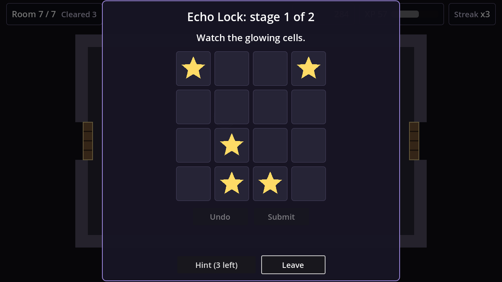

</div>

---

## Contents

- [What is MindForge?](#what-is-mindforge)
- [Screenshots](#screenshots)
- [Features](#features)
- [How the adaptive engine works](#how-the-adaptive-engine-works)
- [Puzzle families](#puzzle-families)
- [Trustworthy content pipeline](#trustworthy-content-pipeline)
- [Getting started](#getting-started)
- [Controls](#controls)
- [Testing and quality gates](#testing-and-quality-gates)
- [Project structure](#project-structure)
- [Roadmap](#roadmap)
- [Design principles](#design-principles)
- [Documentation](#documentation)
- [Assets and licensing](#assets-and-licensing)
- [Development workflow](#development-workflow)

---

## What is MindForge?

MindForge is a **2D top-down puzzle-dungeon game** built with **Godot 4.5** and GDScript. Every run generates a new dungeon. Each chamber holds a puzzle from one of three families (**pattern**, **logic** or **memory**), and the last chamber is a two-stage **guardian trial**.

Behind the dungeon runs a **deterministic adaptive engine**. It keeps a separate rating and confidence for each puzzle family, predicts your chance of success for every candidate puzzle, and picks the next room so standard chambers land in a **70–80 % predicted-success band**. Strong players get harder puzzles; players who are struggling get breather rooms, familiar mechanics and more support. The game never labels anyone weak or strong.

Everything runs **fully offline**. Puzzles come from a validated local bank plus **solver-first procedural generators**, and every puzzle has a deterministic answer key. A puzzle never relies on prose or on an AI's claimed answer.

```text
Enter room → Solve the puzzle → Measure performance → Update family skill
     ↑                                                        ↓
Open the next room ← Reward score & XP ← Pick the next puzzle in the target band
```

---

## Screenshots

<table>
  <tr>
    <td align="center" width="50%">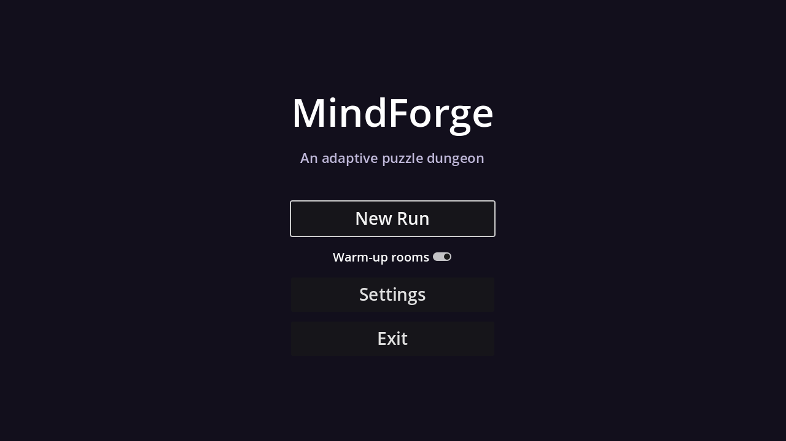<br><sub><b>Main menu</b>: New Run, optional warm-up rooms, settings</sub></td>
    <td align="center" width="50%">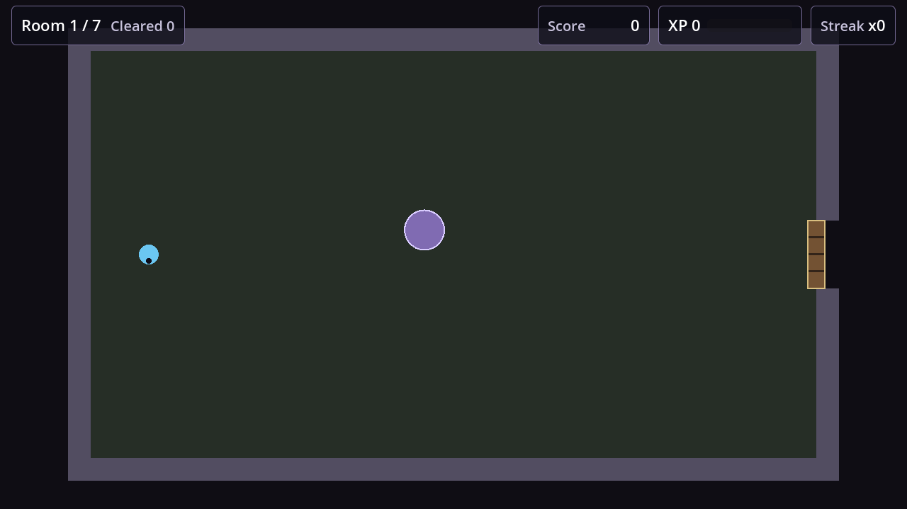<br><sub><b>Generated room</b>: HUD with room, score, XP level progress and streak</sub></td>
  </tr>
  <tr>
    <td align="center">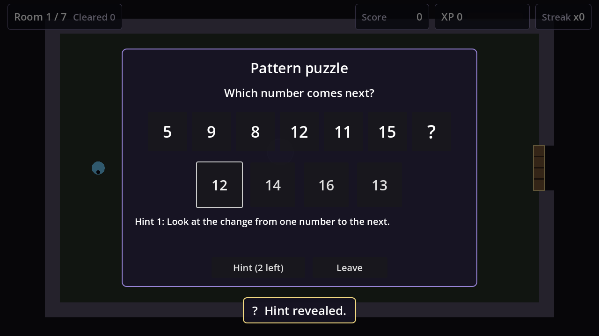<br><sub><b>Pattern puzzle</b>: alternating-step sequence with a revealed hint</sub></td>
    <td align="center">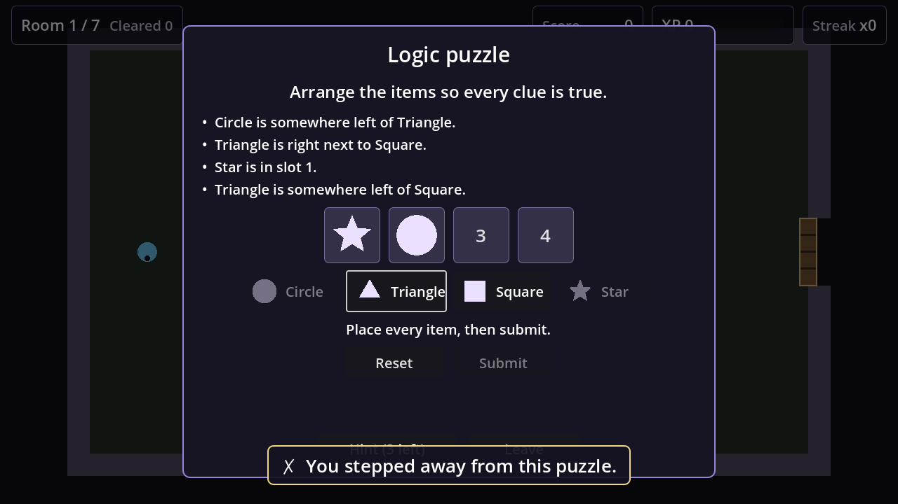<br><sub><b>Logic puzzle</b>: place items so every structured clue holds</sub></td>
  </tr>
  <tr>
    <td align="center">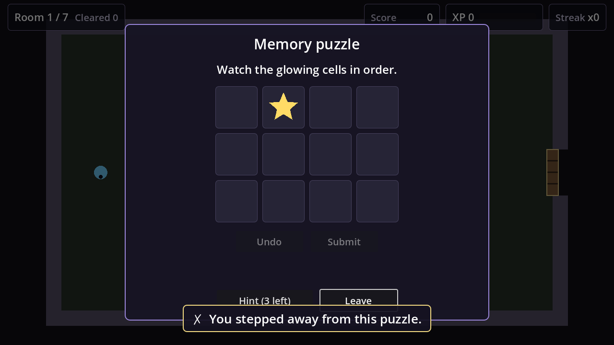<br><sub><b>Memory puzzle</b>: show phase (cells light up in order)</sub></td>
    <td align="center">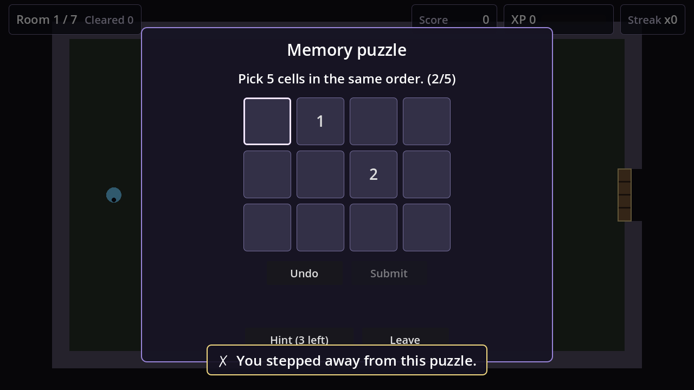<br><sub><b>Memory puzzle</b>: answer phase (pick order shown as numbers)</sub></td>
  </tr>
  <tr>
    <td align="center">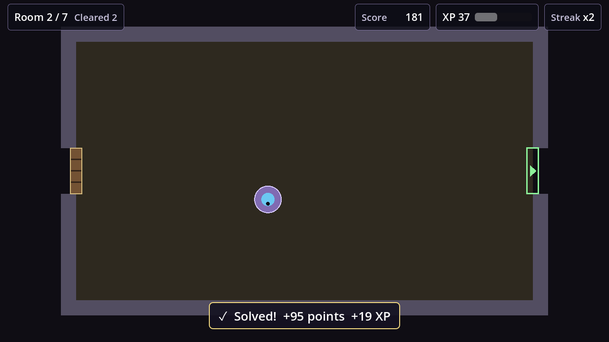<br><sub><b>Feedback</b>: points and XP, exit door opens</sub></td>
    <td align="center"><br><sub><b>Guardian trial</b>: two stages from different families</sub></td>
  </tr>
  <tr>
    <td align="center">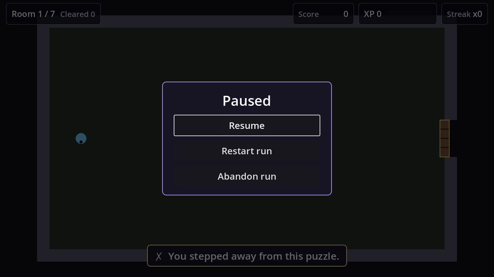<br><sub><b>Pause</b>: resume, restart with the same seed, abandon (with confirmation)</sub></td>
    <td align="center">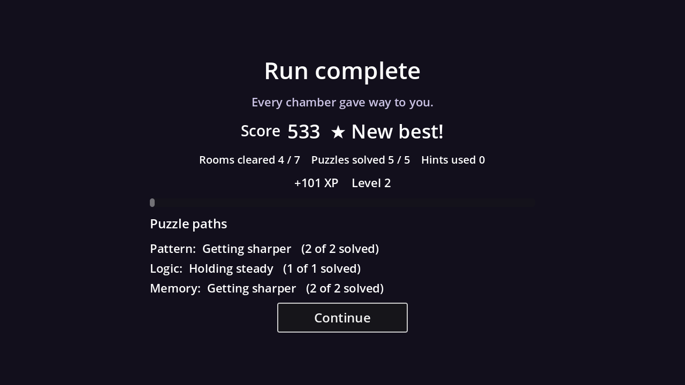<br><sub><b>Run summary</b>: friendly per-family trends, no labels</sub></td>
  </tr>
  <tr>
    <td align="center">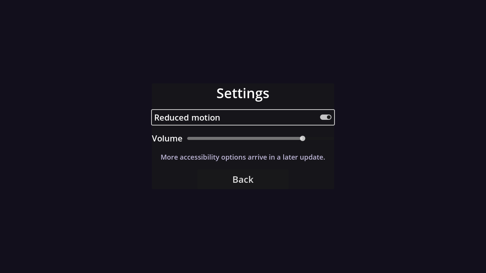<br><sub><b>Settings</b>: reduced motion and master volume</sub></td>
    <td align="center"><sub>All screenshots are captured from the real build with<br><code>tools/capture_screenshots.gd</code></sub></td>
  </tr>
</table>

---

## Features

### 🎯 Adaptive difficulty that stays fair
- **Per-family skill** (pattern, logic, memory) plus an overall rating, each with **confidence** and an observation count. Being strong at one family never inflates another.
- **Elo-style updates** with confidence-aware K: newcomers settle quickly, experienced players move gradually, and every puzzle is capped at ±45 rating points. Parameters were tuned with simulated players (Phase 7).
- **Predicted-success targeting**: standard rooms aim for 70–80 %; breather, challenge and boss rooms have their own bands.
- **Anti-oscillation**: consecutive targets are smoothed and step-capped, so one lucky answer or one slip never swings the dungeon.
- **Recovery mode with hysteresis**: after repeated failures the game eases off (without trivialising) and returns to normal only after a stable success streak.
- **Warm-up calibration**: three gentle rooms for a new profile, one per family; you can skip them.

### 🧩 Content that is always solvable
- **Three puzzle families** with deterministic solvers and validators.
- **Solver-first procedural generators**: a seed picks structured parameters, and the solver derives the answer. Difficulty comes from structure (rule depth, item count, clue types, path length and scatter), never from obscure wording.
- **Logic uniqueness**: generated logic puzzles have exactly one solution, and harder ones need every clue.
- **One 8-stage validation pipeline** for bundled, procedural and (future) AI content.

### 🏰 Procedural dungeon
- **Seeded 7-room runs** with varied room sizes, layouts, retreat rules and a boss room at the end. The same seed always rebuilds the same dungeon.
- **Variety guardrails**: cooldowns on recent puzzles, mechanics and families; the weakest family is practised but never drilled.

### 🏆 Scoring, progression and feedback
- **Deterministic scoring**: base × difficulty × speed × hint × attempt × streak, each multiplier capped. Speed can only change a score by ±10 %.
- **XP and levels** reward effort and are deliberately **not** a measure of skill.
- **Run summary** with player-friendly trends ("Getting sharper", "Holding steady"). Raw numbers appear only in debug mode.
- **Feedback banners** with symbols (✓ ↻ ✗ ★ ◆); they never reveal answers.

### ♿ Accessibility and safety
- **Reduced motion** and **master volume** settings.
- **Accessibility-safe timing**: when a timing accommodation is on, slower play never lowers your inferred skill or your score.
- **No colour-only information**: every symbol is a distinct shape.
- **Keyboard and controller** navigation from the first frame.

### 💾 Robust saving
- **Versioned atomic saves**: write a temp file, verify it, keep a backup, then replace.
- **Migrations**, **corruption recovery** from backup, and a guarantee that a save from a newer version is never overwritten.

---

## How the adaptive engine works

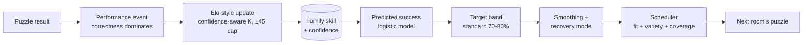

| Concept | Rule (v1) |
|---|---|
| Expected success | `1 / (1 + 10^((difficulty − skill) / 250))` |
| Observed score | correct ≥ 0.45, incorrect ≤ 0.20; capped penalties for extra attempts (0.3 each), hints and slowness |
| Update | `Δ = clamp(K × (observed − expected), −45, +45)`, with K from 90 (new) down to 14 (confident) |
| Target bands | recovery 0.85–0.93 · standard 0.70–0.80 · challenge 0.55–0.68 · boss 0.45–0.60 |
| Recovery | enter after 3 failures in 4 (or 2 hint exhaustions / abandons); exit after 3 straight successes |

All parameters live in [`game/scripts/adaptive/adaptive_config.gd`](game/scripts/adaptive/adaptive_config.gd) and are design hypotheses meant to be calibrated with simulations ([Phase 7](#roadmap)). Turn on `mindforge/debug/adaptive_log` in Project Settings to print every scheduling decision with its reasons.

---

## Puzzle families

| Family | Mechanics | Canonical answer comes from | Difficulty levers |
|---|---|---|---|
| **Pattern** | arithmetic, geometric, alternating steps, recurrence (Fibonacci-like), symbol cycles | the pattern solver, from structured rule parameters | rule type, step size and sign, visible length, cycle length |
| **Logic** | ordering puzzles with `before`, `adjacent`, `not_adjacent`, `at`, `not_at` clues | an exhaustive solver that verifies **exactly one** solution | item count, number and type of clues, pruning to a minimal clue set |
| **Memory** | sequence recall and position recall on a grid | the stored canonical target (timing is presentation only) | grid size, target length, scatter / interference, recall threshold |

Each puzzle carries its id, family, schema and content version, source, seed, target and calibrated difficulty, difficulty confidence, a hint ladder with costs, a time band, provenance and a **stable SHA-256 fingerprint** of its mechanics.

---

## Trustworthy content pipeline

Every puzzle, whether bundled, procedural or (later) AI-generated, must pass the same gate before it can appear in a room:

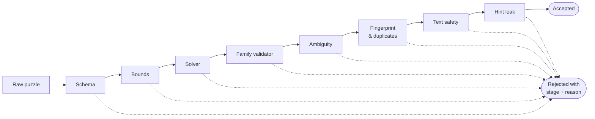

The LLM is never the answer key: in the AI phase it may only propose structured parameters, and the deterministic solver derives and verifies the solution.

---

## Getting started

### Requirements
- **Godot 4.5** (standard build, not .NET). The project is pinned to 4.5 and verified with 4.5.2.
- Windows, Linux or macOS. Tests run headless.

On Windows you can install Godot with winget:

```powershell
winget install GodotEngine.GodotEngine --version 4.5.2
```

### Run the game

```bash
git clone https://github.com/M-Mashreghi/MindForge.git
cd MindForge
godot --path .            # play
godot --path . -e         # open in the editor (then press F5)
```

On Windows with winget, the executable is under `%LOCALAPPDATA%\Microsoft\WinGet\Packages\GodotEngine.GodotEngine_*\`.

### Quick start in game
1. Press **New Run**. Leave **Warm-up rooms** on for a new profile.
2. Walk to the purple pedestal and press **E**.
3. Solve the puzzle (use **Hint** if you need it); the exit door turns green.
4. Clear all seven rooms, including the guardian trial, and read your run summary.

---

## Controls

| Action | Keyboard | Controller |
|---|---|---|
| Move | WASD / arrow keys | Left stick / d-pad |
| Interact with the pedestal | E / Space / Enter | A |
| Navigate menus and puzzles | Arrow keys + Enter | D-pad + A |
| Pause (resume, restart, abandon) / leave a puzzle | Esc | – |
| Toggle internal numbers on the summary (debug builds) | F3 | – |
| Toggle the adaptive debug overlay (debug builds) | F9 | – |

---

## Testing and quality gates

The project ships with its own headless test runner and repository tools:

```bash
GODOT=/path/to/godot tools/run_tests.sh          # 277 headless unit + integration tests
GODOT=/path/to/godot tools/check_boot.sh         # project boots without parser/runtime errors
GODOT=/path/to/godot tools/validate_puzzles.sh   # whole puzzle bank through the content pipeline
GODOT=/path/to/godot tools/precommit_check.sh    # all of the above + whitespace and secret checks
```

What the tests cover includes:

- **Skill model**: determinism, bounds, monotonic predictions, confidence growth and decay, regression fixtures for lucky spikes, one-off failures and alternating results.
- **Recovery and scheduling**: hysteresis without flapping, variety that never blocks selection, the weak family not drilled endlessly.
- **Puzzles**: every invalid fixture is rejected at the right stage; generators produce valid, unique, deterministic puzzles across hundreds of seed and difficulty combinations; first hints never leak answers.
- **Accessibility**: 1× and 3× memory timing give identical correctness; accommodations neutralise timing in both skill and score.
- **Saving**: round trips, migration, corrupted saves with and without a backup, refusal to overwrite newer saves.
- **Gameplay flow**: menu focus, room transitions without double-firing, pause / restart / abandon, boss trials and the run summary.

Headless tools never read or write the player's real save file.

---

## Project structure

```text
MindForge/
├── game/
│   ├── autoload/            # EventBus, GameState, PlayerProfile, SaveManager, Feedback
│   ├── scenes/
│   │   ├── dungeon/         # dungeon flow, player controller
│   │   ├── rooms/           # reusable room + doors (locked / unlocked / solved)
│   │   ├── puzzles/         # family-agnostic PuzzleHost + pattern / logic / memory renderers
│   │   └── ui/              # main menu, HUD, feedback banner, pause menu, run summary
│   ├── scripts/
│   │   ├── adaptive/        # skill profile, Elo, predictor, selector, recovery, calibration, scheduler, planner
│   │   ├── puzzles/         # schema, families, catalog, content pipeline, hint ladder, generators/
│   │   ├── dungeon/         # dungeon generator, boss trials, room metadata
│   │   └── scoring/         # scoring engine, XP progression, run summary
│   └── resources/
│       ├── puzzle_bank/     # bundled pattern / logic / memory puzzles (JSON)
│       └── room_defs/       # fixture rooms
├── tests/                   # headless runner, unit + integration tests, fixtures
├── tools/                   # run_tests, check_boot, validate_puzzles, precommit_check, capture_screenshots
└── docs/                    # design, architecture, adaptive spec, puzzle spec, task ledger, images
```

---

## Roadmap

| Phase | Scope | Status |
|---|---|---|
| 1 | Foundation, repository workflow, playable 2D skeleton | ✅ Done |
| 2 | Puzzle framework and three puzzle families | ✅ Done |
| 3 | Player modeling and adaptive difficulty | ✅ Done |
| 4 | Scoring, progression, save and player feedback | ✅ Done |
| 5 | Procedural dungeon and content scheduling | ✅ Done |
| 6 | AI puzzle generation behind a safe, solver-first pipeline | ⏳ Next |
| 7 | Telemetry, simulated players and difficulty calibration | 📋 Planned |
| 8 | Polish, accessibility options, CI/CD and release | 📋 Planned |

Every task has a dedicated, tested commit: 44 of 72 tasks are complete. See [`docs/TASKS.md`](docs/TASKS.md) for the full ledger and [`docs/PROJECT_PHASES_AND_TASKS.md`](docs/PROJECT_PHASES_AND_TASKS.md) for each task's contract and implementation notes.

---

## Design principles

- **Correctness dominates.** Speed is a small, bounded secondary signal, and it is ignored whenever accessibility timing is active.
- **Deterministic where it matters.** Skill, confidence, predictions, scores, XP and generated content are reproducible from their inputs and seeds.
- **The LLM is never the answer key.** AI may propose parameters; solvers decide.
- **Variety over the numerically closest puzzle.** Fit, novelty and family coverage are balanced.
- **Never label the player.** Feedback describes the run, not the person.
- **Offline first.** The core game is complete without any network or AI service.

---

## Documentation

| Document | What it covers |
|---|---|
| [Game design](docs/GAME_DESIGN.md) | fantasy, core loop, scoring, failure, accessibility |
| [Architecture](docs/ARCHITECTURE.md) | systems and dependency rules |
| [Adaptive difficulty](docs/ADAPTIVE_DIFFICULTY.md) | skill model, bands, recovery, implementation table |
| [Adaptive evaluation](docs/ADAPTIVE_EVALUATION.md) | simulation archetypes and release gates |
| [Puzzle spec](docs/PUZZLE_SPEC.md) | schema, result contract, hints, content pipeline |
| [Save and telemetry](docs/SAVE_AND_TELEMETRY.md) | save format, atomic writes, privacy |
| [AI content policy](docs/AI_CONTENT_POLICY.md) | what AI may and may not do |
| [Git workflow](docs/GIT_WORKFLOW.md) | per-task commits and pre-commit checks |
| [Task ledger](docs/TASKS.md) | progress for all 72 tasks |

---

## Assets and licensing

All art is drawn in code (shapes and style boxes), and all sound effects are short tones **synthesized in code** at startup ([`game/autoload/feedback.gd`](game/autoload/feedback.gd)). The repository ships **no third-party art, audio or fonts**; the UI uses Godot's built-in default font.

---

## Development workflow

MindForge is built task by task with [Claude Code](https://claude.com/claude-code), following a strict per-task workflow:

```text
Implement → Test / validate → Update docs → Review diff → Commit with task id → Push → Verify
```

Commit format: `task(<task-id>): <short imperative summary>`, for example `task(3.5): add predicted-success model`. Follow-up fixes use `fix(<task-id>): ...`. See [`CLAUDE.md`](CLAUDE.md) and [`docs/GIT_WORKFLOW.md`](docs/GIT_WORKFLOW.md).

To continue development in Claude Code:

```text
Read CLAUDE.md and all project governance documents.
Inspect the next task in docs/PROJECT_PHASES_AND_TASKS.md.
Implement only that task, run every required check, update the task ledgers,
then create a task-scoped commit, push it to GitHub, and verify the push.
```
