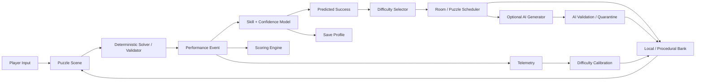

# MindForge Architecture

## High-Level Architecture



## Core Systems

### GameState
Owns run progression and scene transitions.

### PlayerProfile
Owns persistent progression, family skill ratings, confidence, and observation counts.

### PuzzleController
Presents puzzle data and emits standardized performance events.

### PuzzleSolver / PuzzleValidator
Derives/verifies canonical solutions using family-specific deterministic logic.

### SkillModel
Updates overall/family skill and confidence.

### SuccessPredictor
Estimates probability of success from player skill and puzzle difficulty.

### DifficultySelector
Chooses a target predicted-success band and corresponding difficulty band.

### PuzzleScheduler
Chooses family/source while balancing:
- difficulty fit,
- novelty,
- recent repetition,
- family coverage,
- recovery state.

### DifficultyCalibration
Uses aggregated local telemetry to update empirical puzzle difficulty only when sample size is sufficient.

### ScoringEngine
Computes deterministic points from performance.

### TelemetryRecorder
Writes local structured events with algorithm/puzzle provenance.

### AIContentAdapter
Optional structured-content client. It never updates skill, score, or canonical answers.

## Scene Philosophy

Prefer reusable scene composition:
- `DungeonRoom.tscn`
- `PuzzleHost.tscn`
- family-specific puzzle scenes,
- common HUD scene.

## Dependency Rule

```text
Presentation / Scenes
        ↓
Game Services
        ↓
Domain Systems
        ↓
Resources / Persistence
```

UI must not own adaptive logic.

## Offline First

A complete gameplay session must work with networking disabled.

## AI Boundary

```text
AI proposal
→ structured parser
→ sanitizer
→ deterministic solver
→ validator
→ uniqueness check
→ fingerprint check
→ accepted cache
```

AI content that fails any blocking gate cannot enter active gameplay.
